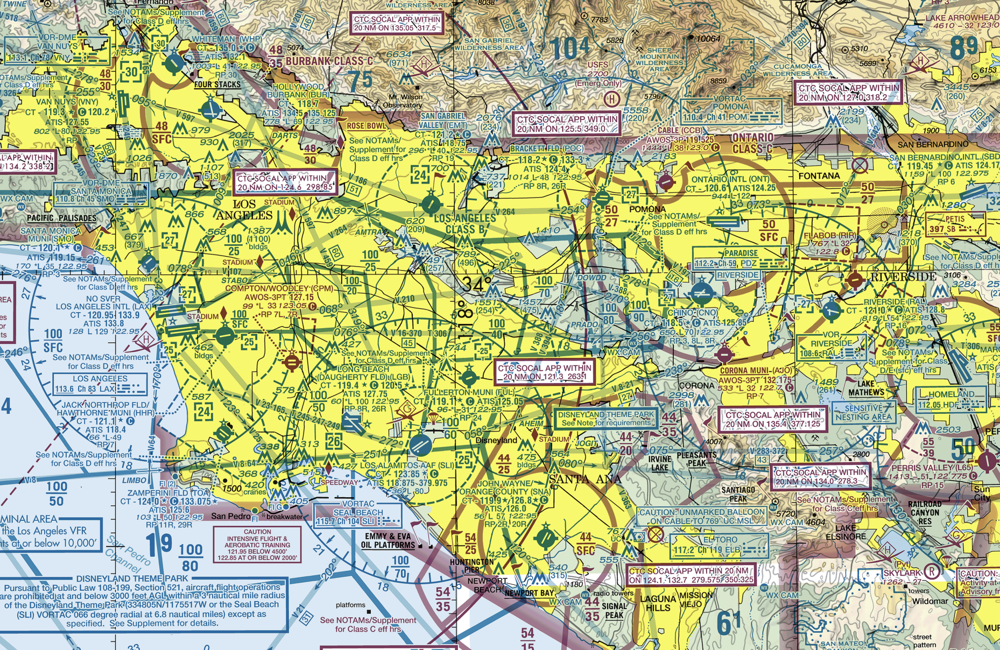
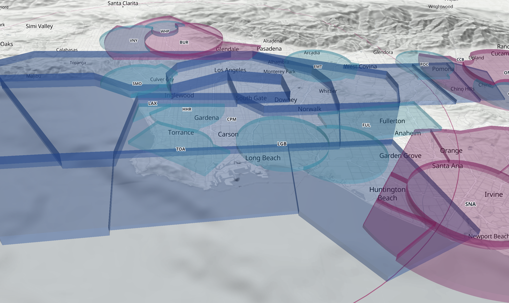

# AirViz

**A 3D map of US airspace for pilots, updated every FAA cycle.**

[](https://airviz.gabrielortiz.io)
[](https://github.com/gabrielortiz00/airviz/actions/workflows/update-airspace.yml)
[](https://github.com/gabrielortiz00/airviz/commits/main)
[](LICENSE)

Interactive 3D visualization of the US National Airspace System, built to give pilots a better spatial understanding of the airspace they're flying in.

**Live:** [airviz.gabrielortiz.io](https://airviz.gabrielortiz.io)

## The Problem

Pilots learn airspace from flat, 2D sectional charts published by the FAA. These charts are the authoritative source and every pilot needs them, but they're notoriously hard to picture as the 3D volumes they really are. This is especially true for student pilots who are new to aviation.

Class B airspace around busy airports like SFO or LAX is made of stacked layers at different altitude ranges. The upside-down wedding cake is the picture instructors draw for every student, including me. On a sectional, it looks like a mess of concentric circles with altitude numbers scattered around. In reality, it's a 3D shape you're either inside of or not.

AirViz solves this by rendering the airspace as 3D volumes on top of an interactive map.

Example: a cut-out of the Los Angeles Sectional Aeronautical Chart as of September 3, 2026:



AirViz renders that same airspace in 3D:



## What it does

- Shows all Class B, C and D airspace in the US, including Alaska, Hawaii and the territories, as 3D volumes at their published floors and ceilings, on top of real terrain.
- Hover over a volume to see its name and altitudes, like "SFC up to but not including 1,500 MSL".
- Shows airport identifiers (OAK, HWD) on the map, with smaller airports appearing as you zoom in.
- Search for an airport by identifier, name or city (PAO, KPAO, "palo alto") and the map flies there, tilted so the airspace shows in 3D.
- Toggle Class B, C and D to declutter busy areas.
- Show the Mode C veil: the 30 NM ring around the busiest airports where you need a transponder with altitude reporting and ADS-B Out.
- Tells you which FAA data cycle you're looking at, with a warning when it's out of date.

**This is a learning tool. Not for navigation.**

## How it works

The airspace data comes from the FAA's [NASR subscription](https://www.faa.gov/air_traffic/flight_info/aeronav/aero_data/NASR_Subscription/), which is updated every 28 days. It's the same source professional aviation apps use. Each cycle includes a shapefile with every Class B, C, D and E area in the country.

`scripts/build-airspace.sh` turns that shapefile into the file the site loads, in three steps:

1. **Export.** GDAL's `ogr2ogr` pulls out every Class B, C and D area, keeping only the fields the site needs. The FAA draws arcs with a point every few meters, so the shapes get simplified to about 2 m. That makes the file about 15 times smaller (2.2 MB gzipped for the whole country) with no visible difference.
2. **Fix overlaps** (`scripts/resolve-overlaps.js`). The FAA stores each airport's airspace as its full shape, so they overlap. In reality you're only ever in one airspace at a time, and the legal descriptions settle who owns what with "excluding ..." clauses that aren't in the shapefile. The script cuts each volume wherever a higher class sits on it (B over C over D), only in the altitude band where they overlap. For the rare case of two Class D areas overlapping, it follows a small rules file I fill in from the legal text. For example, Moffett's Class D excludes Palo Alto's. If a new overlap shows up without a rule, the build stops so I can look it up and verify it.
3. **Check** (`scripts/check-airspace.js`). The result gets tested against known points from the sectional and the legal descriptions. For example: at 1,499 ft over Hayward you're in Hayward's Class D, at 1,500 ft you're not. If any check fails, the build fails.

The same build also makes two smaller files. `scripts/build-airports.js` turns the FAA's airport list into the 5,000 or so public-use airports the search box uses. `scripts/build-mode-c-veil.js` draws the Mode C veil, which isn't in the NASR data at all. 14 CFR 91.215 defines it as 30 NM around a list of airports in Appendix D to Part 91, so the veil is built from that list and each airport's position, with overlapping circles merged (New York's JFK, LaGuardia and Newark become one ring). Each build also checks the list against the current regulation on eCFR and stops if it changed.

In the browser, MapLibre draws the base map and the terrain, and deck.gl draws the airspace volumes inside the same map so they line up with the ground.

## Tech Stack


- [MapLibre GL JS](https://maplibre.org/): base map and 3D terrain
- [deck.gl](https://deck.gl/): 3D airspace volumes
- [OpenFreeMap](https://openfreemap.org/): basemap tiles from OpenStreetMap data
- [AWS Terrain Tiles](https://registry.opendata.aws/terrain-tiles/): elevation data
- [GDAL](https://gdal.org/) and [polyclip-ts](https://github.com/luizbarboza/polyclip-ts): data pipeline
- Vanilla JavaScript with [Vite](https://vite.dev/)

## Running Locally

You need Node 20.19 or newer.

```bash
npm install
npm run dev
```

Then open http://localhost:5173. The airspace data is already in `public/data/`, so that's all it takes.

### Updating the airspace data

This happens on its own. A GitHub Actions workflow (`.github/workflows/update-airspace.yml`) runs every morning. On the day a new NASR cycle takes effect, it downloads the Class Airspace shapefile from the FAA, runs the build with all its checks, and commits the new data if everything passes. If anything fails, it opens a GitHub issue instead and the previous cycle data is kept.

To do it by hand:

1. Install GDAL (`brew install gdal`), or have QGIS installed. The script uses the copy of GDAL that comes with QGIS if it can't find one.
2. Download a cycle with `scripts/fetch-nasr.sh 2026-10-29`. It saves only the shapefile, in a gitignored `28DaySubscription_Effective_2026-10-29` folder. Unzipping the full subscription from the [NASR page](https://www.faa.gov/air_traffic/flight_info/aeronav/aero_data/NASR_Subscription/) into the repo root works too.
3. Run `npm run build:airspace`.

The build uses the newest cycle folder, writes `airspace.geojson`, `cycle.json`, `airports.json` and `mode-c-veil.geojson` to `public/data/`, and runs the checks. `node scripts/nasr-cycle.js` prints the cycle in effect today.

## License

MIT
