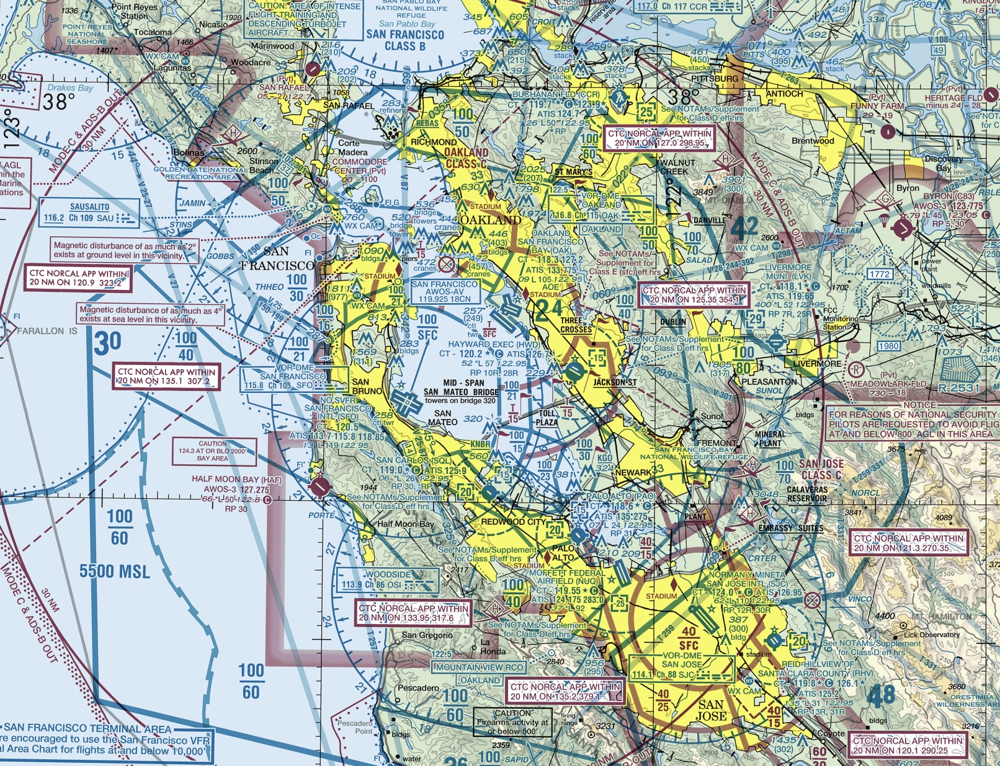
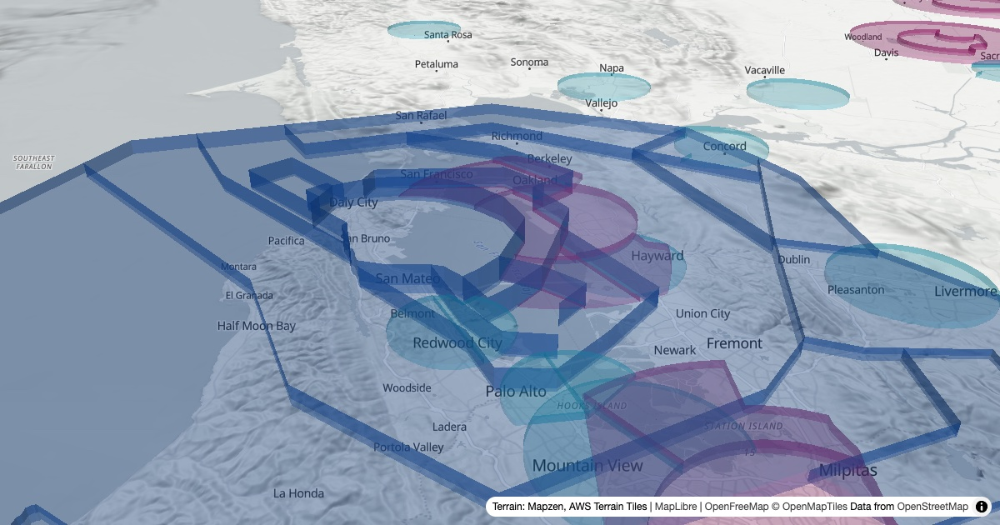

# AirViz

Interactive 3D visualization of the US National Airspace System, built to give pilots a better spatial understanding of the airspace they're flying in.

**Live:** [airviz.gabrielortiz.io](https://airviz.gabrielortiz.io)

## The Problem

Pilots, especially students, learn airspace from sectional charts, flat, 2D maps that make it genuinely hard to build an accurate mental model of what the airspace actually looks like in three dimensions. Class B airspace around a busy terminal like San Francisco stacks multiple shelves at different altitudes, like an upside-down wedding cake. On a sectional, that's a mess of concentric circles with altitude numbers scattered everywhere. In reality, it's a specific 3D volume you either are or aren't inside.

AirViz puts that structure in 3D, in the browser, on top of a real interactive map.

Example: A cut-out of the San Francisco Sectional Area Chart as of 04/14/2026:


AirViz renders that same airspace in 3D:


## What it does

- Shows all Class B, C and D airspace in the US, including Alaska, Hawaii and the territories, as 3D volumes at their real floors and ceilings, on top of real terrain.
- Hover over a volume to see its name and altitudes, written the way you'd read them off a chart, like "SFC up to but not including 1,500 MSL".
- Tells you which FAA data cycle you're looking at, and warns you when it's out of date.

It's a learning tool. Don't use it for navigation.

## How it works

The airspace data comes from the FAA's [NASR subscription](https://www.faa.gov/air_traffic/flight_info/aeronav/aero_data/NASR_Subscription/), which is updated every 28 days. It's the same source professional aviation apps use. Each cycle includes a shapefile with every Class B, C, D and E area in the country.

`scripts/build-airspace.sh` turns that shapefile into the file the site loads, in three steps:

1. **Export.** GDAL's `ogr2ogr` pulls out every Class B, C and D area, keeping only the fields the site needs. The FAA draws arcs with a point every few meters, so the shapes get simplified to about 2 m. That makes the file about 15 times smaller (2.2 MB gzipped for the whole country) with no visible difference.
2. **Fix overlaps** (`scripts/resolve-overlaps.js`). The FAA stores each airport's airspace as its full shape, so they overlap. In reality you're only ever in one airspace at a time, and the legal descriptions settle who owns what with "excluding ..." clauses that aren't in the shapefile. The script cuts each volume wherever a higher class sits on it (B over C over D), only in the altitude band where they overlap. For the rare case of two Class D areas overlapping, it follows a small rules file I fill in from the legal text. For example, Moffett's Class D excludes Palo Alto's. If a new overlap shows up without a rule, the build stops so I can look it up instead of guessing.3. **Check** (`scripts/check-airspace.js`). The result gets tested against known points from the sectional and the legal descriptions. For example: at 1,499 ft over Hayward you're in Hayward's Class D, at 1,500 ft you're not. If any check fails, the build fails.

In the browser, MapLibre draws the base map and the terrain, and deck.gl draws the airspace volumes inside the same map so they line up with the ground.

## Tech Stack

- [MapLibre GL JS](https://maplibre.org/): base map and 3D terrain
- [deck.gl](https://deck.gl/): 3D airspace volumes
- [OpenFreeMap](https://openfreemap.org/): basemap tiles from OpenStreetMap data
- [AWS Terrain Tiles](https://registry.opendata.aws/terrain-tiles/): elevation data
- [GDAL](https://gdal.org/) and [polyclip-ts](https://github.com/luizbarboza/polyclip-ts): data pipeline
- Vanilla JavaScript with [Vite](https://vite.dev/)

## Running Locally

You need Node 20.19 or newer.

```bash
npm install
npm run dev
```

Then open http://localhost:5173. The airspace data is already in `public/data/`, so that's all it takes.

### Updating the airspace data

This happens on its own. A GitHub Actions workflow (`.github/workflows/update-airspace.yml`) runs every morning. On the day a new NASR cycle takes effect, it downloads the Class Airspace shapefile from the FAA, runs the build with all its checks, and commits the new data if everything passes. Vercel deploys that commit. If anything fails, it opens a GitHub issue instead and the site keeps the previous cycle.

To do it by hand:

1. Install GDAL (`brew install gdal`), or have QGIS installed. The script uses the copy of GDAL that comes with QGIS if it can't find one.
2. Download a cycle with `scripts/fetch-nasr.sh 2026-10-29`. It saves only the shapefile, in a gitignored `28DaySubscription_Effective_2026-10-29` folder. Unzipping the full subscription from the [NASR page](https://www.faa.gov/air_traffic/flight_info/aeronav/aero_data/NASR_Subscription/) into the repo root works too.
3. Run `npm run build:airspace`.

The build uses the newest cycle folder, writes `public/data/airspace.geojson` and `public/data/cycle.json`, and runs the checks. `node scripts/nasr-cycle.js` prints the cycle in effect today.

## Status

Live for the whole US, and the data updates itself every NASR cycle.

## Roadmap

- [x] Oakland / San Francisco terminal area
- [x] Automatic data updates every NASR cycle
- [ ] Column view: click a point and see every layer of airspace from the ground up
- [ ] Altitude query: enter a position and altitude, get back the airspace you're in
- [ ] Class E and special use airspace
- [ ] Part-time airspace, like Class D that turns into Class E or G when the tower closes
- [x] Nationwide coverage
- [ ] Real-time flight data overlay
- [ ] Mobile-friendly layout

## License

MIT
